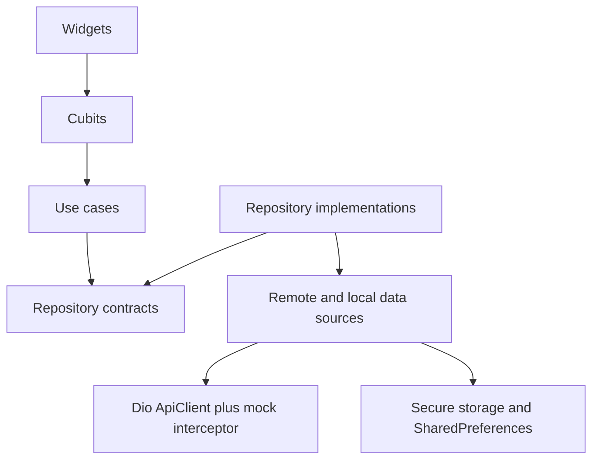

# TaskFlow

Production-style Flutter architecture showcase demonstrating how I build scalable mobile applications.

TaskFlow is a professional project and task manager: sign in, browse projects, search and paginate tasks, edit work, and open items from a deep link. It clones, runs, and tests without a private backend or API keys.

This is a **portfolio project**, not a claim that the app is deployed to production.

## Highlights

- Clean Architecture with inward dependencies
- BLoC/Cubit for session, lists, details, and forms
- GoRouter with auth redirects and deep links
- Constructor injection via GetIt at the composition root
- Dio API client, interceptors, JSON DTOs, failure mapping
- Mock HTTP backend so the app runs offline
- Authentication with secure token storage
- Pagination, search, and filters
- Local persistence (secure token + preferences cache)
- Unit, Cubit, and widget tests
- GitHub Actions CI (format, analyze, test, debug APK)
- Environment configuration (`dev` / `staging` / `prod`)
- Observability seams (`AppLogger`, `CrashReporter`, `Analytics`)

## Architecture



Domain code does not import Flutter, Dio, or Firebase. See [docs/architecture.md](docs/architecture.md).

## Project structure

```text
lib/
  config/env/          # dart-define environments
  core/                # result, failures, network, router, theme, widgets
  features/
    auth/
    projects/
    tasks/
    notifications/
    profile/
  injection/           # GetIt composition root
  app.dart
  main.dart
docs/                  # architecture, ADRs, testing, CI, deep links
test/                  # unit, cubit, widget
.github/workflows/     # CI
```

Each feature follows `presentation → domain → data`.

## Running the project

Requires Flutter 3.41+ (Dart 3.11+).

```bash
git clone <this-repo>
cd taskflow-flutter
flutter pub get
dart run build_runner build
flutter run --dart-define=ENV=dev
```

Other flavors:

```bash
flutter run --dart-define=ENV=staging
flutter run --dart-define=ENV=prod
```

All flavors use the in-memory HTTP mock by default. Base URLs exist so a real API can be swapped in without touching feature code.

### Demo account

| Email | Password |
| --- | --- |
| `jane@taskflow.dev` | `password123` |

Register also works; mock users persist in SharedPreferences for this device only. Passwords are **not** treated as production secrets — this is a local mock.

### Deep links

```text
taskflow://projects/p-1
taskflow://tasks/t-1
```

Details: [docs/deep-linking.md](docs/deep-linking.md).

## Testing

```bash
flutter test
```

See [docs/testing.md](docs/testing.md) for what is covered and why.

## CI/CD

Pull requests run format, analyzer (`--fatal-infos`), tests, then an unsigned Android debug APK. No signing credentials are required.

See [docs/ci-cd.md](docs/ci-cd.md).

## Engineering decisions

Judgment matters more than package count. The important calls:

1. **Mock at the HTTP boundary**, not inside repositories, so Dio, DTOs, and failure mapping stay real.
2. **Custom `Result<T>`** instead of `dartz` — same fold, fewer dependencies.
3. **Cubit over a global store** — list pagination and session restore do not belong in one blob.
4. **Manual GetIt** instead of `injectable` — the graph is small enough to read.
5. **No Firebase packages in the repo** — Crashlytics/Analytics are interfaces with no-op implementations so a public clone never needs keys.
6. **No ScreenUtil / Hive / google_fonts** — they do not earn their complexity here.

Full write-up: [docs/decisions.md](docs/decisions.md).

## License

MIT. See [LICENSE](LICENSE).
